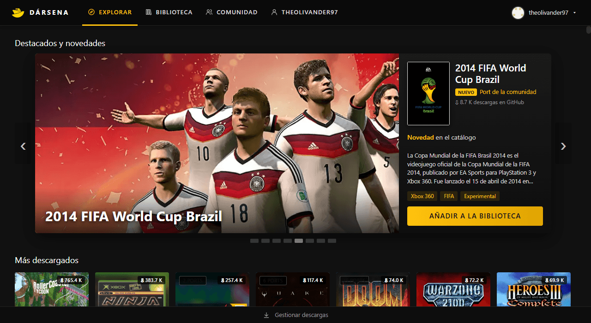
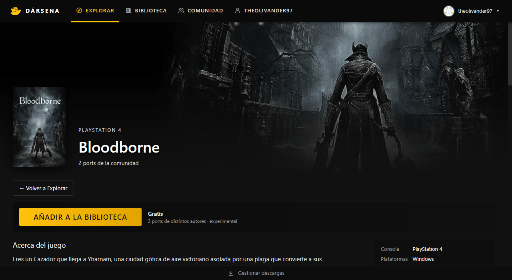
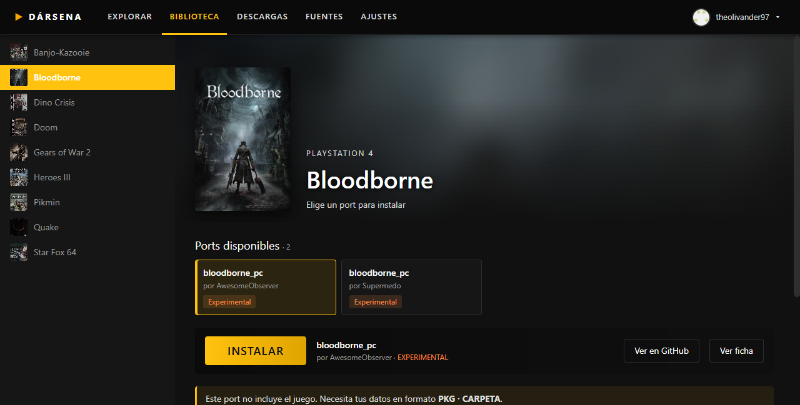

<div align="center">


# DÁRSENA

**El puerto de entrada a los ports de videojuegos hechos por la comunidad.**

Un launcher para descubrir, instalar y jugar ports nativos de PC:
recompilaciones, descompilaciones y motores reescritos de clásicos de consola y de PC.

[](https://github.com/theolivander97/darsena-launcher/releases/latest)
[](https://github.com/theolivander97/darsena-launcher/releases)


### [⬇ Descargar Dársena](https://github.com/theolivander97/darsena-launcher/releases/latest) · [📖 Wiki](https://github.com/theolivander97/darsena-launcher/wiki) · [🎮 Pedir un juego](https://github.com/theolivander97/darsena-launcher/issues/new?template=pedir-un-juego.yml)



</div>

---

## ¿Qué es?

Cada vez salen más **ports nativos** de juegos clásicos: Star Fox 64, Gears of War 2, Bloodborne, Dino Crisis,
Vice City Stories… Cada uno vive en su propio repositorio, con su propia forma de descargarse y de pedirte los archivos
del juego. **Dársena los reúne en un solo sitio**, con la comodidad de una tienda:

- 🧭 **Explorar** un catálogo con más de 400 juegos, con portadas, sinopsis, tráilers y los más descargados.
- 📚 **Biblioteca** propia: añade juegos, elige entre varios ports del mismo juego, instala con un clic y juega.
- ⚡ **Descargas rápidas**: desde las versiones oficiales de GitHub, por torrent o por enlace directo con varias
  conexiones a la vez. Pausar, reanudar y compartir lo que descargas.
- 🧩 **Fuentes**: listas de enlaces que añades tú para traer tus propias copias de los juegos.
- ⭐ **Reseñas, perfil y logros** con tu cuenta de GitHub, y el tiempo de juego de cada título.
- 🔄 **Siempre al día**: el catálogo se actualiza solo y el launcher se actualiza a sí mismo, con firma verificada.

<table>
<tr>
<td width="50%"></td>
<td width="50%"></td>
</tr>
<tr>
<td align="center"><sub>Cada juego tiene su ficha: de qué trata, tráiler y ports disponibles.</sub></td>
<td align="center"><sub>Varios ports del mismo juego: eliges cuál instalar desde la biblioteca.</sub></td>
</tr>
</table>

## Cómo funciona

Dársena separa **tres cosas** que otros launchers mezclan:

| | Qué es | Quién lo pone |
|---|---|---|
| 📋 **Catálogo** | La lista de juegos y de sus ports: nombre, consola, portada, repositorio oficial y qué archivos necesita cada uno. | Lo mantiene el autor de Dársena y se actualiza solo al abrir el launcher. |
| 🔗 **Fuentes** | Listas JSON con enlaces de descarga (torrent, magnet o directo) para ports o para tus datos. | **Tú.** Dársena no trae ninguna. |
| 💾 **Tus datos** | Los archivos del juego original (ROM, ISO, carpeta del disco…) que pide cada port. | **Tú**, desde tu propia copia. |

Al instalar, todo queda ordenado por juego:

```
DarsenaLibrary\
└── Gears of War 2\
    ├── gears-of-war-2-pc-port\   ← el port
    └── Datos\                    ← tus archivos del juego
```

Más detalles en la **[wiki](https://github.com/theolivander97/darsena-launcher/wiki)**: cómo funcionan las fuentes,
los datos del juego, las descargas, la cuenta de GitHub y los logros.

## Descargar e instalar

1. Descarga **`Darsena_<versión>_x64-setup.exe`** desde la [última versión](https://github.com/theolivander97/darsena-launcher/releases/latest).
2. Ejecútalo. Si Windows muestra *«Windows protegió su PC»*, pulsa **Más información → Ejecutar de todas formas**
   (el instalador no lleva firma de código de Microsoft).
3. Abre Dársena: comprobará si hay versiones nuevas y actualizará el catálogo.

**Requisitos:** Windows 10 u 11 de 64 bits. Dársena usa WebView2, que ya viene con Windows 11
(en Windows 10 el instalador lo instala si falta).

## Lo que Dársena no es

> [!IMPORTANT]
> **Dársena no incluye ni distribuye juegos.** Ningún port del catálogo trae los archivos del juego original:
> cada uno necesita **tu propia copia**. Las fuentes son de terceros y cada usuario decide cuáles añade y responde
> de lo que descarga con ellas.

Los ports son obra de sus autores, enlazados a sus repositorios oficiales desde cada ficha.

## Pedir un juego

El catálogo lo mantiene el autor de Dársena para que cada juego que entra funcione y cumpla las normas.
**No se aceptan cambios directos al catálogo**: si conoces un port que debería estar, pídelo con la plantilla
**[Pedir un juego](https://github.com/theolivander97/darsena-launcher/issues/new?template=pedir-un-juego.yml)**.
¿Algo no funciona? Usa **[Reportar un problema](https://github.com/theolivander97/darsena-launcher/issues/new?template=reportar-un-problema.yml)**.

## Licencia

- **Dársena y el catálogo:** © theolivander97, todos los derechos reservados.
- **Las sinopsis de Wikipedia:** [CC BY-SA 4.0](https://creativecommons.org/licenses/by-sa/4.0/deed.es), con la fuente en cada juego.
- **Portadas, capturas, juegos y ports:** de sus respectivos dueños.

## Créditos

- Los **ports** pertenecen a sus autores; cada ficha enlaza a su proyecto.
- **Portadas:** [libretro-thumbnails](https://github.com/libretro-thumbnails/libretro-thumbnails) y [SteamGridDB](https://www.steamgriddb.com/).
- **Sinopsis:** [Wikipedia](https://es.wikipedia.org/) (CC BY-SA 4.0), con la fuente indicada en cada juego.
- Hecho con [Tauri](https://tauri.app/), [Rust](https://www.rust-lang.org/) y [librqbit](https://github.com/ikatson/rqbit).

<div align="center"><sub>Los nombres y marcas de los juegos pertenecen a sus respectivos dueños. Dársena no está afiliado a ninguno de ellos.</sub></div>
